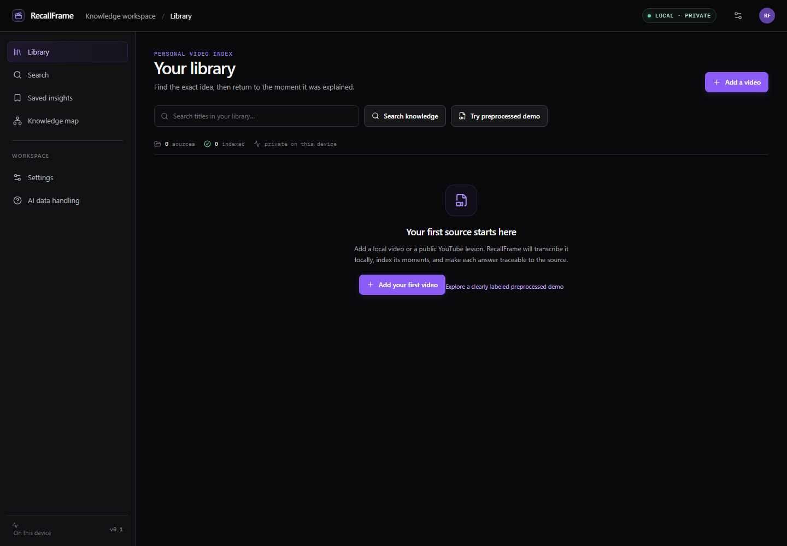

# RecallFrame

RecallFrame is a local-first workspace for learning from video. It turns a video library into searchable transcripts, chapters, evidence-linked concepts, and answers that point back to exact source moments.



## What it does

- Import private MP4, MOV, or WebM files (up to 1 GB and two hours) or one public YouTube video at a time.
- Validate local video streams and duration with FFprobe, then transcribe speech locally with faster-whisper.
- Browse timestamped transcript segments, chapters, and the source player together.
- Search a transcript or the whole library with PostgreSQL full-text search and local multilingual embeddings.
- Ask questions using retrieved source evidence. Answers are restricted to validated evidence IDs and include source timestamps; unsupported questions get an insufficient-evidence response.
- Save insights and browse concepts that link back to evidence in their source.
- Use the preprocessed demo to explore the interface without importing media or running model inference. Demo content is illustrative sample data, not an indexed source.

## Quick start

### Requirements

- Docker Desktop with its Linux engine, or Docker Engine and the Docker Compose v2 plugin.
- An OpenRouter API key for video analysis and AI answers. Local media handling, transcription, embeddings, and search are performed by the app, but a video job cannot complete its AI analysis stage without a configured key.

### Start RecallFrame

1. Clone this repository and open a terminal in its root directory.
2. Copy the environment example to a private local file:

   ```powershell
   Copy-Item .env.example .env
   ```

   On macOS or Linux, use `cp .env.example .env`.

3. Open `.env` in a text editor and set `OPENROUTER_API_KEY`. Keep this file private; it is ignored by Git. The key is passed only to the API and worker containers.
4. Build and start the services:

   ```sh
   docker compose up --build -d
   docker compose ps
   ```

5. Open [http://127.0.0.1:3100](http://127.0.0.1:3100).

The first run downloads container images and local speech/embedding models, so it can take a while and needs available disk space. Follow service output with `docker compose logs -f api worker`. To stop the app while keeping its data, run `docker compose down`.

Set `RECALLFRAME_WEB_PORT` in `.env` if port 3100 is already in use. The web container remains bound to loopback.

## Data flow and privacy

RecallFrame is a single-user, localhost application. It does not provide login, user accounts, or authorization. Docker Compose publishes only the web UI on `127.0.0.1`; the API, PostgreSQL, and Redis are internal to the Compose network. **Do not expose this deployment to a LAN, reverse proxy, or the public internet.** Add and review authentication and authorization before changing its network exposure.

- Uploaded media and database records live in persistent local Docker volumes. Uploaded files remain until deleted in RecallFrame. YouTube downloads and temporary processing files are removed after processing.
- Speech transcription and text embeddings run locally. Library search uses the local PostgreSQL database.
- For a video analysis job, the worker creates compressed five-minute chunks and deterministic timestamped JPEG frames locally. It sends those frames and relevant transcript context to OpenRouter/NVIDIA after the per-video consent step. It does not send the full local video file through OpenRouter's video input route.
- For Q&A, RecallFrame sends only the top retrieved evidence passages for that video to OpenRouter. The server validates returned evidence IDs and builds citations from its stored transcript/evidence records.
- YouTube playback uses YouTube's embedded player. Importing a YouTube video also downloads its media temporarily for local processing.
- OpenRouter's current [Nemotron endpoint notice](https://openrouter.ai/nvidia/nemotron-3.5-super-vl:free) warns against sending confidential or personal information and says NVIDIA may log submissions for service improvement. Do not analyze sensitive media with this endpoint. Provider pricing, availability, limits, and data terms can change; review the linked notice before use.

The direct OpenRouter video modality may have provider-specific eligibility or balance requirements. RecallFrame uses timestamped image frames instead; the model and its video-input behavior are described in the [OpenRouter model page](https://openrouter.ai/nvidia/nemotron-3.5-super-vl:free) and [video input documentation](https://openrouter.ai/docs/guides/overview/multimodal/videos).

## Configuration

The root `.env.example` lists supported settings and safe local defaults.

| Variable | Purpose | Default |
| --- | --- | --- |
| `OPENROUTER_API_KEY` | Server-side key for video analysis and Q&A | Empty; set in `.env` |
| `OPENROUTER_MODEL` | OpenRouter model slug | `nvidia/nemotron-3.5-super-vl:free` |
| `RECALLFRAME_WEB_PORT` | Loopback port for the web UI | `3100` |
| `WHISPER_MODEL` | faster-whisper model | `small` |
| `EMBEDDING_MODEL` | Local sentence-transformers model | `sentence-transformers/paraphrase-multilingual-MiniLM-L12-v2` |
| `MAX_UPLOAD_MB` | Maximum uploaded file size | `1024` |
| `MAX_VIDEO_DURATION_SECONDS` | Maximum source duration | `7200` |

Database, Redis, API URL, and media-storage settings in the example are Compose-internal defaults. Change them only when you understand the service networking and volume configuration.

## Development

The application runs entirely in Docker Compose. For frontend and API development outside the containers, install Node.js 24, pnpm 10.28.1 (or enable it with Corepack), and Python 3.12. Install the API dependencies into a virtual environment so the Python tests and OpenAPI generator can run:

```sh
python -m venv .venv
# Activate .venv for your shell, then:
python -m pip install -r services/api/requirements.txt
corepack enable
pnpm install
pnpm verify
pnpm format:check
```

`pnpm verify` runs frontend linting and type checking, the frontend and API unit tests, and a production frontend build. To run only the API tests:

```sh
python -m pytest services/api/tests -q
```

To regenerate the committed OpenAPI contract and TypeScript declarations after an API schema change, install the API's Python requirements locally and run:

```sh
pnpm generate:api
```

Use `docker compose up --build` to build and run the full application. Changes to Python API or worker code require rebuilding the corresponding images.

## Architecture

| Area | Implementation |
| --- | --- |
| Web app | Next.js App Router, React, TypeScript |
| API | FastAPI, SQLAlchemy, Alembic |
| Jobs | Celery worker with Redis broker |
| Database | PostgreSQL 18 with pgvector and full-text search |
| Media | FFprobe/FFmpeg, local Docker volume, faster-whisper (`small`, CPU int8 by default) |
| Retrieval | Local multilingual MiniLM embeddings with lexical/vector rank fusion |
| AI analysis and Q&A | OpenRouter structured output; source references checked against stored evidence |

Useful project documents:

- [Architecture decisions](design-notes/architecture-decisions.md)
- [AI pipeline](design-notes/ai-pipeline.md)
- [Product experience](design-notes/product-experience.md)
- [Prior-art and license notes](prior-art/licenses-and-attributions.md)

## Data management

Use the Delete video action in a source workspace to remove that video and its derived records. `docker compose down` stops the services and preserves data. To remove all Docker-managed RecallFrame data, including uploaded videos and the database, run:

```sh
docker compose down --volumes
```

That command permanently deletes RecallFrame's persistent local volumes.

## Limitations

- This is an experimental local, single-user application; it is not hardened for shared or internet-facing deployment.
- Transcription can miss speech, especially in music-heavy or low-volume videos. Empty transcripts and model-generated content should be checked against the source.
- YouTube support is limited to public, individual videos that can be downloaded by yt-dlp. Playlists, live streams, private or restricted videos, and unsupported hosts are rejected or may fail at download time.
- AI output quality, free-tier availability, and provider behavior vary. RecallFrame validates evidence references, but users should verify important conclusions against the cited video moments.
- Imported content must be content the user has the right to process. You are responsible for respecting applicable platform terms and content rights.

## Contributing

Bug reports and design feedback are welcome. The project owner should add a license before accepting code contributions or inviting reuse. Once that is in place, pull requests should describe the behavior change, update relevant documentation, and pass `pnpm verify` and `pnpm format:check`. Never commit `.env`, local media, transcripts containing private material, model caches, or other user data.

## License

This repository does not currently include a `LICENSE` file. The project owner should choose and add a license before presenting the repository as open source or inviting reuse and contributions.
